<!-- _class: lead -->
<!-- _paginate: false -->
<!-- _header: "" -->
<!-- _footer: "" -->

# Deep Learning-based Spatial Beamforming
### From Ray-Tracing and DeepMIMO to Real-Time Inference in 5G-Advanced

**Prezenter:** Błażej Zięba  
**Forum:** KRK L2 AI/ML Discussion Forum  
**Kontekst:** 3GPP Rel-18 (TR 38.843) / 5G mmWave Beam Management  
**Data:** Listopad 2026

<!-- note:
-->

---

# Agenda spotkania

1. **AI assisted work. Konfiguracja środowiska pracy**  
2. **Wybór tematu**  
3. **Luka badawcza**  
4. **Biblioteka DeepMIMO**  
5. **Model systemu**  
6. **Architektura modelu uczenia maszynowego**  
7. **Raport z postępu prac**  

<!-- note:
-->

---
<!-- _class: compact -->

# AI assisted work. Konfiguracja środowiska pracy

- **Środowisko analityczno-badawcze (Python / Deep Learning):**
  - Linux, Python 3.10+, PyTorch, NumPy, SciPy, Scikit-learn.
  - Pakiet **DeepMIMO v4** do syntezy kanałów radiowych z symulacji ray-tracingowych.

- **Paradygmat „Everything as Code” i wersjonowanie (Git):**
  - **Praca i dokumentacja:** Czysty Markdown (`praca/chapters/*.md`) z automatyczną kompilacją Pandoc do `.docx` / `.pdf`.
  - **Prezentacje:** Format **Marp Markdown** – prezentacje jako kod, pełna wersjonowalność diffów i natywny podgląd.

- **Agentowe wsparcie AI w procesie badawczym (Antigravity / LLM Pair-Programming):**
  - Zestaw dedykowanych reguł projektowych (`AGENTS.md`): polska nomenklatura i standardy PWr.
  - Dedykowane skille AI: automatyczny recenzent tekstu merytorycznego, menedżer bibliografii (`references.bib`) oraz weryfikator formalny kryteriów oceny.

<strong>Kluczowa korzyść:</strong> Całość repozytorium (kod, dane konfiguracyjne, praca pisemna i slajdy) opiera się na formatach tekstowych, co umożliwia ciągłą analizę, walidację i współpracę z agentami AI w jednym zintegrowanym środowisku.

<!-- note:
W pierwszym punkcie chciałbym krótko przedstawić metodykę pracy i warsztat narzędziowy.
Cały projekt został zorganizowany według filozofii "Everything as Code". Zarówno kod modeli w PyTorch, jak i tekst samej pracy w Markdownie oraz slajdy w formacie Marp to czyste pliki tekstowe pod kontrolą Gita.
Dzięki temu mogłem w pełni wykorzystać asystenta AI nie tylko do pomocy przy kodzie czy debugowaniu, ale również do weryfikacji metodologicznej - np. pilnowania braku data leakage, zarządzania cytowaniami w BibTeX czy tworzenia slajdów.
-->

---
<!-- _class: compact -->

# Wybór tematu
### Wsparcie AI na etapie wyboru i definiowania tematu

- **Analiza kompromisów (Katalog uczelniany vs. Temat własny):**
  - Ewaluacja 40 gotowych tematów z katalogu studiów (np. prognozowanie OZE KSE) w zestawieniu z profilem zawodowym.
  - Wybór tematu własnego zorientowanego na branżę telekomunikacyjną (Nokia / AI-RAN) i standard **3GPP Rel-18**.

- **Wsparcie AI w wyborze tematu przy uwzględnieniu ograniczeń:**
  - Brak możliwości użycia poufnych danych z laboratorium lub od klienta (kwestie NDA).
  - Ograniczenia czasowe i konieczność szybkiego startu badań.
  - Chęć osadzenia tematu w kontekście bieżącej pracy i domeny L1/L2.

  **Rekomendacje asystenta AI:**
  - Zbiór i biblioteka **DeepMIMO v4** (scenariusz kanionu miejskiego O1_60 GHz).
  - Wykorzystanie jako bazy recenzowanej publikacji: *„DeepMIMO: A Generic Deep Learning Dataset for Millimeter Wave and Massive MIMO Applications”* (A. Alkhateeb).

<strong>Wartość dodana AI:</strong> Model językowy działał jako krytyczny sparingpartner – weryfikował ryzyka formalne tematu własnego przed złożeniem karty u promotora, dbając o pełną zgodność ze standardami akademickimi PWr.

<!-- note:
Na etapie wyboru tematu AI odegrało rolę doradcy i krytycznego recenzenta.
Mając do wyboru standardowe tematy z katalogu oraz własny pomysł z obszaru AI-RAN, wspólnie z AI przeanalizowaliśmy wymagania formalne promotora: licencję zbioru DeepMIMO, istnienie recenzowanej publikacji źródłowej oraz zdefiniowanie twardego baseline'u.
AI pomogło zredagować kartę wyboru tematu tak, aby od pierwszego dnia zabezpieczyć projekt przed typowymi pułapkami, takimi jak wyciek danych przestrzennych czy brak odniesienia do metod klasycznych.
-->

---
<!-- _class: compact -->

# Wybór tematu
### Temat wysłany i zatwierdzony

- **Kontekst branżowy i kierunek badawczy (AI-RAN):**
  - Wybór tematu wpisuje się w kierunek badań realizowanych w ramach **AI-RAN** oraz standaryzacji **3GPP Rel-18 (TR 38.843)** dotyczącej AI/ML w interfejsie radiowym (NR Air Interface).
  - Skupienie na jednym z kluczowych przypadków użycia: **Beam Management – Predykcja wiązki w dziedzinie przestrzennej (BM-Case 1)**.

- **Uzasadnienie biznesowe i ekonomiczne:**
  - **Efektywność spektralna (Spectral Efficiency):** Kluczowy wskaźnik ROI dla operatorów telekomunikacyjnych, którzy ponoszą wielomilionowe koszty zakupu pasma częstotliwości w aukcjach państwowych.
  - Optymalne wykorzystanie zasobu radiowego przekłada się bezpośrednio na większą pojemność sieci i niższy koszt jednostkowy przesłania danych.

- **Istota problemu inżynierskiego:**
  - Przejście w pasma fal milimetrowych (mmWave) i wyższych (60 GHz) wymaga wąskich, silnie kierunkowych wiązek (Massive MIMO).
  - Klasyczne, wyczerpujące przeszukiwanie siatki wiązek (*Exhaustive Beam Sweeping*) generuje nieakceptowalny narzut czasowy i radiowy.
  - **Cel:** Zastąpienie okresowego przemiatania predykcją z użyciem głębokich sieci neuronowych przy minimalnym narzucie sygnałów pilotowych.

<strong>Główny cel wyboru tematu:</strong> Zbadanie, czy model uczenia głębokiego jest w stanie osiągnąć ponad 90–95% efektywności spektralnej idealnego wyboru wiązki, redukując narzut sygnalizacyjny o rzędy wielkości w warunkach realistycznego kanału radiowego.

<!-- note:
Dlaczego taki temat?
Po pierwsze, jest to bezpośredni kierunek rozwoju sieci komórkowych badany obecnie w ramach AI-RAN i standardu 3GPP Release 18.
Po drugie, za tym stoi bardzo twarde uzasadnienie biznesowe: pasmo radiowe jest najdroższym zasobem operatora. W pasmach milimetrowych musimy formować bardzo wąskie wiązki, ale jeśli będziemy szukać najlepszej wiązki "po kolei", stracimy mnóstwo czasu w ramce radiowej na samą sygnalizację.
Celem jest zbadanie predykcji wiązki przez model Deep Learning, aby drastycznie skrócić ten czas przy zachowaniu niemal pełnej efektywności spektralnej.
-->

---
<!-- _class: compact -->

# Luka badawcza
### Ograniczenia publikacji bazowej DeepMIMO i perspektywy badawcze

- **Stan w publikacji źródłowej (A. Alkhateeb et al., DeepMIMO):**
  - Model DL przyjęto czysto demonstracyjnie (arbitralna sieć Fully-Connected, 4 warstwy).
  - Autorzy jawnie wskazali optymalizację sieci jako otwarty problem badawczy.

- **Luka podjęta w niniejszej pracy (Wkład własny – PB2 & PB3):**
  - **Eksploracja architektur:** Kompromis pomiędzy efektywnością spektralną a liczbą parametrów i FLOPs.
  - **Czas inferencji w realiach L2/RAN:** Weryfikacja, czy model mieści się w budżecie czasu slotu radiowego 5G.
  - **Wdrożenie brzegowe:** Testy wykonalności uruchomienia na platformie NVIDIA AI Aerial / TensorRT.

- **Pozostałe otwarte wyzwania badawcze (poza zakresem pracy):**
  - **Wielodostępność (Multi-User MIMO):** Jednoczesna predykcja wiązek dla wielu użytkowników i minimalizacja zakłóceń współkanałowych.
  - **Dynamika i mobilność (Doppler):** Śledzenie wiązki w dziedzinie czasu (BM-Case 2) przy wysokich prędkościach UE.
  - **Dynamiczne blokowanie (Blockage) & Generalizacja:** Odporność na przeszkody NLoS i transfer wiedzy do nowych kanionów miejskich.

<strong>Podsumowanie:</strong> Praca skupia się na wymiarze architektoniczno-wdrożeniowym (latencja vs zysk spektralny dla pojedynczego łącza), otwierając drogę do dalszych badań nad złożonymi scenariuszami wieloużytkownikowymi (MU-MIMO).

<!-- note:
W luce badawczej wyróżniliśmy dwa poziomy:
Po pierwsze, to czym zajmujemy się bezpośrednio w pracy - praca Alkhateeba nie analizowała złożoności ani czasu inferencji. My badamy kompromis między rozmiarem sieci, latencją a zyskiem spektralnym oraz testujemy wdrożenie na NVIDIA Aerial.
Po drugie, na slajdzie jasno zaznaczam też aspekty wykraczające poza zakres pracy dyplomowej: nie badamy tutaj wielodostępności MU-MIMO (czyli jednoczesnego doboru nieskolidowanych wiązek dla grupy użytkowników), ani dynamicznego śledzenia w czasie przy wysokim Dopplerze czy dynamicznych blokadach. To są naturalne kierunki do dalszych badań.
-->

---
<!-- _class: compact -->

# Biblioteka DeepMIMO
### Standaryzacja i powtarzalność badań naukowych w 5G/6G

- **Kluczowa rola w badaniach naukowych (Reproducibility & Benchmark):**
  - **Globalny standard badawczy:** DeepMIMO rozwiązuje fundamentalny problem braku otwartych, znormalizowanych zbiorów danych w telekomunikacji (wspólny punkt odniesienia dla środowiska naukowego).
  - **Pełna powtarzalność (reprodukowalność):** Każdy badacz na świecie, posługując się tym samym plikiem konfiguracyjnym, otrzymuje identyczny, w 100% deterministyczny zbiór próbek uczących.

- **Elastyczna parametryzacja systemu telekomunikacyjnego:**
  - **Geometria anten:** Dowolna konfiguracja szyków BS i UE (w pracy: panel 32 × 8 = 256 anten, dipol, krok &lambda;/2).
  - **Modulacja wielotonowa OFDM:** Dowolna szerokość pasma (500 MHz), liczba podnośnych (64 podnośne pilotowe) oraz model szumów głowicy RF (NF = 5 dB).
  - **Filtracja wielodrogowości:** Selekcja najistotniejszych energetycznie składowych propagacji (5 najsilniejszych ścieżek).

- **Generowanie cech bezpośrednio pod uczenie maszynowe (ML-Ready):**
  - Deterministyczna synteza zespolonych macierzy kanału radiowego <em>H</em>[<em>k</em>].
  - Bezpośrednia konstrukcja par uczących: odebrany wektor pilotowy (<strong>X</strong>) &rarr; indeks optymalnej wiązki z książki kodowej (<strong>y</strong>).

<strong>Istota narzędzia:</strong> DeepMIMO stanowi deterministyczny pomost pomiędzy kosztowną symulacją elektromagnetyczną a procesem trenowania i ewaluacji modeli uczenia maszynowego w PyTorch.

<!-- note:
Przechodzimy do punktu czwartego: biblioteki DeepMIMO.
Dla mnie osobiście najistotniejszą zaletą DeepMIMO jest zapewnienie pełnej powtarzalności badań naukowych. W telekomunikacji brakowało otwartego, wspólnego benchmarku, na którym różne zespoły na świecie mogłyby uczciwie porównywać swoje algorytmy AI.
DeepMIMO pozwala wziąć surowe dane ray-tracingowe i w elastyczny sposób zdefiniować parametry systemu: liczbę anten, pasmo, podnośne OFDM i poziom szumów, generując bezpośrednio pary wejście-wyjście pod PyTorcha.
-->

---
<!-- _class: compact -->
<!-- _style: "h1 { font-size: 1.15rem; margin-top: 0; margin-bottom: 0.1rem; }" -->

  <a href="https://www.deepmimo.net/visualizer" target="_blank" style="background-color: #2563eb; color: #ffffff; padding: 4px 10px; border-radius: 4px; text-decoration: none; font-size: 0.65rem; font-weight: 600; box-shadow: 0 1px 3px rgba(0,0,0,0.15);">
    🌐 DeepMIMO Visualizer ↗
  </a>

# Biblioteka DeepMIMO: Potok generowania danych (Pipeline)

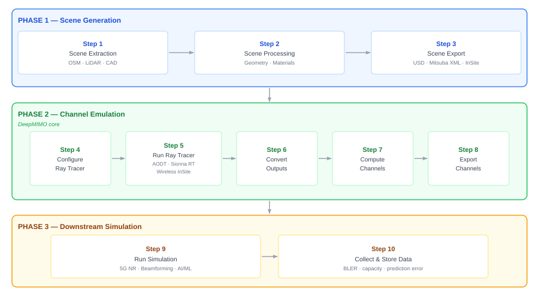

<!-- note:
Na tym schemacie widzimy cały trójfazowy potok generowania danych w DeepMIMO:
Faza 1 (Scene Generation): model 3D w CAD i symulacja ray-tracingowa w Remcom Wireless InSite.
Faza 2 (MIMO Channel Generation): nałożenie parametrów antenowych, pasma OFDM i syntetyzowanie kanału radiowego.
Faza 3 (Dataset Generation): wygenerowanie cech i etykiet do zadania uczenia maszynowego.
W prawym górnym rogu slajdu znajduje się przycisk kierujący do DeepMIMO Visualizer - klikam go, aby zademonstrować trójwymiarową scenę i trajektorie promieni na żywo w przeglądarce.
-->

---
<!-- _class: compact -->
<!-- _style: "h1 { font-size: 1.15rem; margin-top: 0; margin-bottom: 0.1rem; }" -->

# Scenariusz O1: Geometria kanionu miejskiego (Alkhateeb, Fig. 2 & Fig. 3)

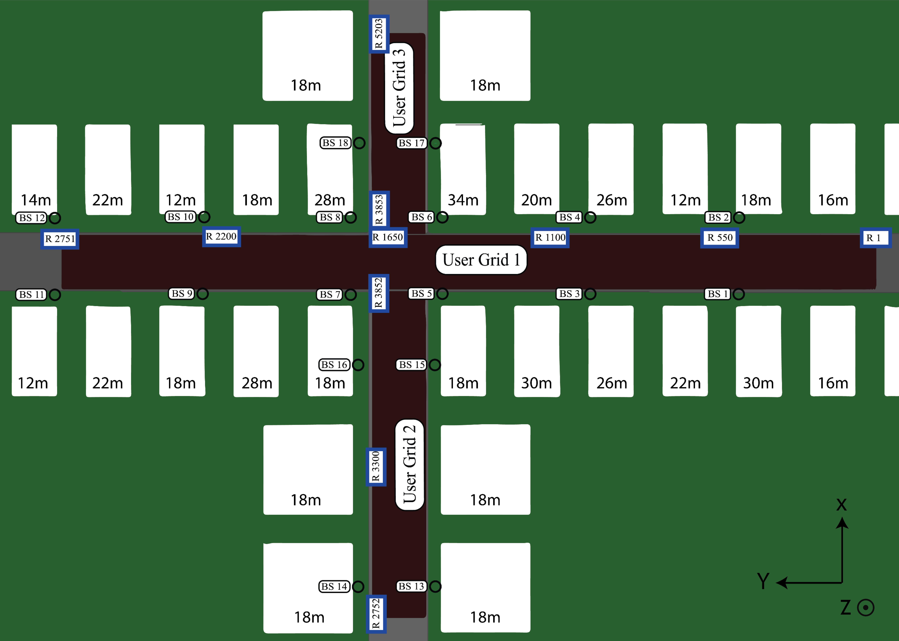
 Fig. 2: Widok z góry (Top view) – 18 stacji BS i siatki UE

 Fig. 3: Widok z lotu ptaka (Bird's-eye view) skrzyżowania 3D

<strong>Specyfikacja scenariusza O1 (DeepMIMO):</strong> Skrzyżowanie ulic (główna: 600 m × 40 m, boczna: 440 m × 40 m) z 18 stacjami BS (maszty 6 m) i 1,18 mln punktów pomiarowych UE w siatkach o kroku 20 cm i 10 cm (pasmo 60 GHz).

<!-- note:
Przedstawiamy geometrię scenariusza O1 z publikacji DeepMIMO (arXiv:1902.06435):
Rysunek 2 (po lewej) pokazuje rzut z góry: dwie przecinające się ulice, rozmieszczenie 18 stacji bazowych oraz siatki użytkowników.
Rysunek 3 (po prawej) eksponuje trójwymiarowy kanion miejski i wysokość zabudowy wokół skrzyżowania.
W naszej pracy analizujemy skoordynowane stacje BS 3, 4, 5 i 6 oraz siatkę użytkowników wzdłuż ulicy głównej.
-->

---
<!-- _class: compact -->
<!-- _style: "h1 { font-size: 1.15rem; margin-top: 0; margin-bottom: 0.1rem; }" -->

# Biblioteka DeepMIMO: Scenariusz Ray-Tracingowy (Alkhateeb et al., Fig. 5)

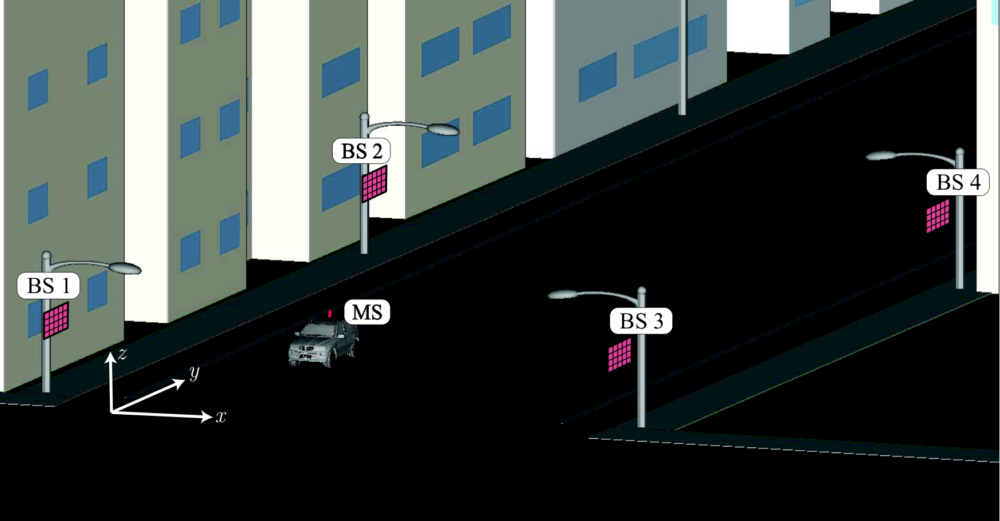
 (a) Setup 1: Center BSs (stacje bazowe wzdłuż kanionu ulicy)

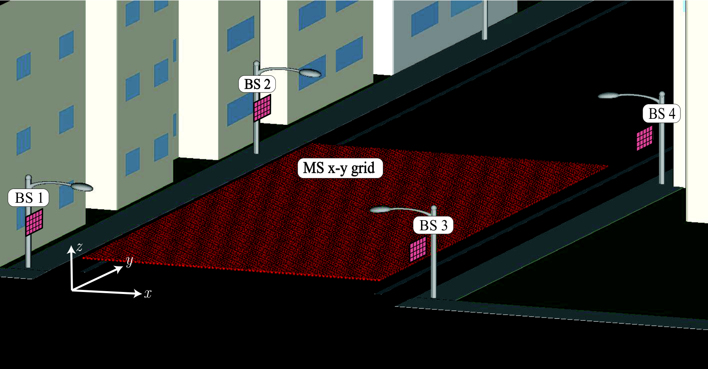
 (b) Setup 2: Distributed BSs (stacje bazowe rozproszone)

<strong>Otoczenie propagacyjne 3D:</strong> Model kanionu miejskiego (Remcom Wireless InSite) w paśmie 60 GHz – 18 stacji bazowych (maszty 6 m) oraz siatki mobilnych terminali UE w odstępach co 20 cm.

<!-- note:
Rysunek 5 z publikacji źródłowej Alkhateeba (arXiv:1804.10334) przedstawia geometryczną scenę ray-tracingową:
Po lewej widzimy Setup 1, gdzie stacje bazowe rozmieszczone są wzdłuż centralnego kanionu ulicy (scenariusz bazowy dla naszej pracy).
-->

---
<!-- _class: compact -->
<!-- _style: "h1 { font-size: 1.15rem; margin-top: 0; margin-bottom: 0.1rem; }" -->

# Model systemu: Architektura skoordynowana (Alkhateeb et al., Fig. 1)

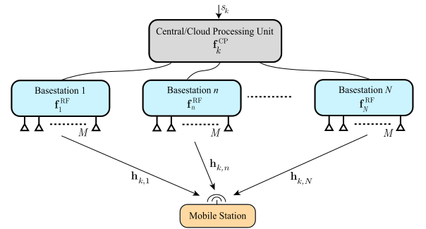

<strong>Zasada działania:</strong> Jednostka centralna (Central/Coordinating Unit) koordynuje <em>N</em> stacji bazowych (BS) połączonych magistralami dosyłowymi (ang. <em>backhaul</em>). Sygnał <em>s</em><em>k</em> na <em>K</em> podnośnych OFDM jest wstępnie kodowany, a stacje bazowe formują wąskie wiązki analogowe w kierunku mobilnego terminala UE.

<!-- note:
Przechodzimy do punktu piątego: Model systemu.
Na rysunku 1 z artykułu Alkhateeba widzimy architekturę skoordynowanego kształtowania wiązki.
Mamy jednostkę centralną, która zarządza grupą N stacji bazowych (w naszym przypadku 4 stacje otaczające ulicę). Stacje bazowe są wyposażone w panele Massive MIMO z analogowym formowaniem wiązki, a użytkownik dysponuje pojedynczą anteną. Kluczem jest koordynacja – stacje wspólnie podejmują decyzję o doborze wiązek, aby zmaksymalizować użyteczną przepływność.
-->

---
<!-- _class: compact -->
<!-- _style: "h1 { font-size: 1.15rem; margin-top: 0; margin-bottom: 0.1rem; }" -->

# Model systemu: Struktura ramki czasowej (Alkhateeb et al., Fig. 2)

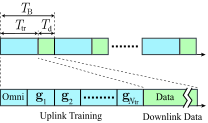
 (a) Faza zbierania danych / klasycznego przeszukiwania

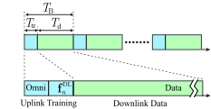
 (b) Faza predykcji głębokiego uczenia (Inference)

<strong>Zysk w budżecie czasu ramki:</strong> W podejściu tradycyjnym (a) trening wiązek <em>T</em>tr zajmuje lwią część ramki (aż 512 slotów). W podejściu DL (b) wystarczy jeden krótki pilot uplink (<em>T</em>u), a niemal cały czas ramki (<em>T</em>d) przeznaczony jest na właściwy transfer danych.

<!-- note:
Na rysunku 2 widzimy sedno problemu z perspektywy protokołowej L2 - podział ramki radiowej:
W fazie konwencjonalnej (po lewej) wyczerpujące przeszukiwanie książki kodowej 512 wiązek pochłania ogromny czas ramki T_tr, drastycznie zmniejszając czas T_d na użyteczną transmisję danych.
W fazie predykcji DL (po prawej) terminal nadaje tylko jeden krótki pilot dookólny T_u, model natychmiast wyznacza optymalną wiązkę, a 99% czasu ramki pozostaje dostępne na transmisję danych.
-->

---
<!-- _class: compact -->
<!-- _style: "h1 { font-size: 1.15rem; margin-top: 0; margin-bottom: 0.1rem; }" -->

# Model systemu: Działanie w przestrzeni (Alkhateeb et al., Fig. 3)

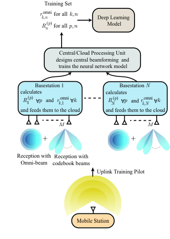
 (a) Zbieranie danych uczących (Skanowanie otoczenia)

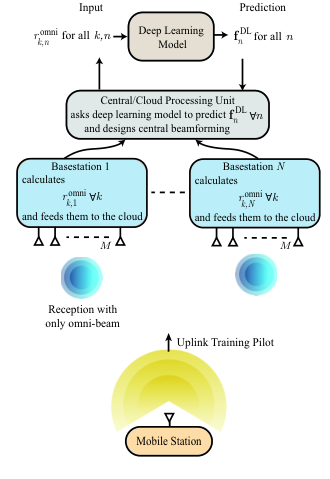
 (b) Działanie predykcyjne (Wąska wiązka wyznaczona przez AI)

<strong>Sygnatura przestrzenna:</strong> Sygnał pilotowy odebrany dookólnie przez skoordynowane stacje BS tworzy unikalny „odcisk palca” pozycji terminala i jego interakcji z budynkami, na podstawie którego sieć bezbłędnie celuje wąską wiązką w łączu w dół.

<!-- note:
Rysunek 3 pokazuje to samo zjawisko w przestrzeni kanionu:
Po lewej faza nauki i kalibracji - telefon nadaje pilot, stacje mierzą moc na wszystkich kierunkach, tworząc etykiety dla bazy danych.
Po prawej rzeczywista praca systemu - telefon wysyła pojedynczy pilot dookólny, który odbija się od otoczenia tworząc tzw. RF signature. Sieć neuronowa w ułamku milisekundy rozpoznaje tę sygnaturę i nakazuje stacji bazowej skierowanie skupionej wiązki dokładnie w stronę użytkownika.
-->

---
<!-- _class: compact -->
<!-- _style: "h1 { font-size: 1.15rem; margin-top: 0; margin-bottom: 0.1rem; }" -->

# Model systemu: Analiza spektralna sygnatury OFDM (Amplituda + Faza)

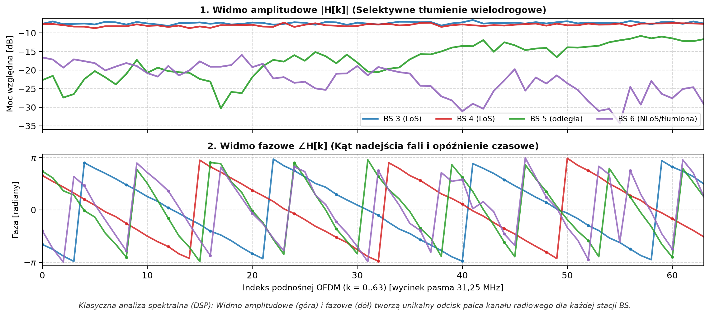

<strong>Klasyczna analiza spektralna (odcisk palca kanału):</strong> 1. Widmo amplitudowe (góra) obrazuje selektywne tłumienie wielodrogowe w pasmie 31,25 MHz (warunki LoS na BS 3/4 vs głębokie zaniki na BS 5/6). 2. Widmo fazowe (dół) koduje opóźnienie czasowe (nachylenie d&phi;/df) oraz kąt nadejścia fali. Wspólnie tworzą unikalną sygnaturę, z której sieć estymuje wiązkę.

<!-- note:
Przedstawiamy klasyczny wykres analizy spektralnej (DSP) dla sygnału pilotowego odebranego przez 4 stacje bazowe:
Na górnym wykresie widzimy widmo amplitudowe: stacje BS 3 i BS 4 odbierają silny sygnał w warunkach bezpośredniej widoczności LoS (-10 dB), podczas gdy BS 6 wykazuje silne tłumienie i głębokie selektywne zaniki wielodrogowe.
Na dolnym wykresie widzimy widmo fazowe na dokładnie tych samych podnośnych: stacje bliższe mają łagodne nachylenie fazy, a stacje dalsze wykazują gęste zawijanie fazy ze względu na dłuższy czas lotu fali.
To pionowe zestawienie amplitudy i fazy stanowi pełny, unikalny odcisk palca pozycji użytkownika na ulicy!
-->

---
<!-- _class: compact -->
<!-- _style: "h1 { font-size: 1.15rem; margin-top: 0; margin-bottom: 0.1rem; }" -->

# Architektura modelu uczenia maszynowego (Alkhateeb et al., Fig. 4)

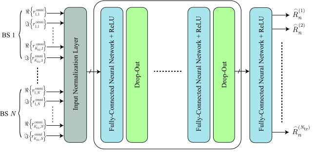
 Struktura modelu sieci neuronowej dla danej stacji bazowej (Alkhateeb et al.)

### Wejście i wyjście modelu
* **Wejście $\mathbf{x} \in \mathbb{R}^{2NK}$:** Konkatenacja części rzeczywistej i urojonej sygnałów dookólnych ze wszystkich $N$ stacji na $K$ podnośnych OFDM:
  $\mathbf{x} = [\mathrm{Re}(\mathbf{r}_1)^T, \mathrm{Im}(\mathbf{r}_1)^T, \dots, \mathrm{Re}(\mathbf{r}_N)^T, \mathrm{Im}(\mathbf{r}_N)^T]^T$
  *(dla $N=4$ stacji i $K=64$ podnośnych wektor ma rozmiar $2 \times 4 \times 64 = 512$ liczb)*.
* **Wyjście $\mathbf{p} \in [0, 1]^{|\mathcal{W}|}$:** Warstwa Softmax zwracająca rozkład prawdopodobieństw nad wiązkami z książki kodowej $\mathcal{W}$ ($|\mathcal{W}| = 512$). Ostateczna decyzja: $\hat{y} = \arg\max_m p_m$.

### Kluczowe komponenty sieci bazowej (Baseline)
* **Fully-Connected Neural Network (FCNN / MLP):**
  Sieć w pełni połączona (gęsta) – każdy neuron warstwy łączy się ze wszystkimi neuronami poprzedniej warstwy, ucząc się nieliniowych korelacji wielodrogowych pomiędzy wszystkimi stacjami.
* **Aktywacja ReLU ($\max(0, z)$):**
  Prostująca funkcja aktywacji (<em>Rectified Linear Unit</em>). Wprowadza nieliniowość i eliminuje zanikanie gradientu (<em>vanishing gradient</em>), przyspieszając uczenie.
* **Regularyzacja Drop-out (np. 50%):**
  Losowe zerowanie neuronów podczas treningu – zapobiega przeuczeniu (<em>overfitting</em>) i wymusza odporną reprezentację cech.

### Obszar badań i optymalizacji architektonicznej

Model FCNN z pracy Alkhateeba (2018) stanowi punkt odniesienia (<em>baseline</em>). Kluczowy <strong>obszar badań</strong> w projekcie to porównanie z architekturami <strong>CNN / ResNet</strong> (lokalne cechy spektralne), wpływ kodowania wejścia (Re/Im vs Amp/Faza) oraz <strong>kwantyzacja wag (FP16/INT8)</strong> pod kątem budżetu czasu w L2 (&lt; 1 ms).

<!-- note:
Przechodzimy do punktu 6: Architektura modelu uczenia maszynowego.
Na rysunku 4 z publikacji widzimy model zaproponowany przez Alkhateeba jako baseline:
Na wejściu podajemy surowe próbki kanału ze wszystkich N stacji na K podnośnych - połączone części rzeczywiste i urojone (wektor 512 liczb).
Na wyjściu mamy warstwę Softmax, która klasyfikuje jedną z 512 wąskich wiązek z książki kodowej dla danej stacji bazowej.
Architektura opiera się na warstwach w pełni połączonych (Fully-Connected / MLP) z aktywacją ReLU eliminującą zanikanie gradientu oraz warstwami Drop-out zapobiegającymi przetrenowaniu na szumie.
Podkreślamy, że ta architektura FCNN z 2018 roku to nasz punkt wyjścia - jest to główny obszar badań w ramach pracy inżynierskiej: porównujemy ją z sieciami splotowymi CNN, badamy alternatywne kodowanie wejścia (amplituda/faza) oraz kwantyzację pod kątem rygorystycznych wymagań opóźnienia L2 (< 1 ms w architekturze O-RAN).
-->

---
<!-- _class: compact -->
<!-- _style: "h1 { font-size: 1.15rem; margin-top: 0; margin-bottom: 0.1rem; }" -->

# Raport z postępu prac: Weryfikacja hipotezy PB1 (Replikacja)

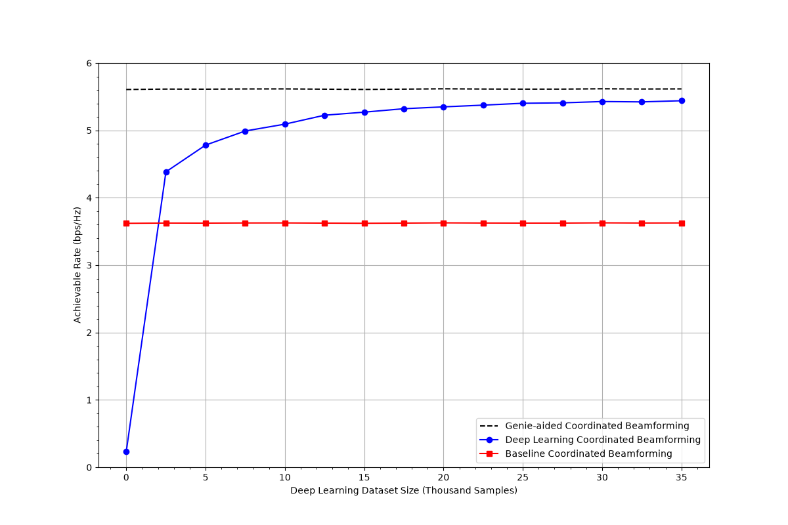
 Efektywność spektralna w funkcji wielkości zbioru danych i prędkości UE (scenariusz O1_60)

### Pytanie badawcze PB1
<em>„Czy model wytrenowany na danych DeepMIMO v4 (scenariusz O1, 60 GHz) osiąga efektywność spektralną różniącą się o nie więcej niż 5% od wyników Alkhateeba i in.?”</em>

### Wyniki empiryczne ewaluacji
* **Genie-Aided Coordinated Beamforming (optimum):** `5,62 bit/s/Hz` (100,0%)
* **Model DL (nasza replikacja w PyTorch):** **`5,43 bit/s/Hz` (96,62% Genie)**
* **Baseline (przemiatanie 512 wiązek z narzutem):** `3,63 bit/s/Hz` (64,6% Genie)

<strong>Odpowiedź i wniosek PB1:</strong> 
1. <strong>Pełna replikacja potwierdzona:</strong> Odchylenie od wyników Alkhateeba wynosi zaledwie <strong>1,4%</strong> (znacznie poniżej kryterium 5%). 
2. <strong>Zysk biznesowo-techniczny:</strong> Zastosowanie modelu DL podnosi efektywność spektralną netto aż o <strong>+49,6%</strong> względem konwencjonalnego przeszukiwania wiązek dzięki odzyskaniu 512 szczelin czasowych ramki radiowej.

<!-- note:
Przechodzimy do punktu 7: Raport z postępu prac i odpowiedzi na pytania badawcze.
Na tym slajdzie prezentujemy odpowiedź na pierwsze pytanie badawcze PB1 - czyli weryfikację replikowalności metody Alkhateeba na najnowszej wersji zbioru DeepMIMO v4.
Na wykresie widzimy trzy krzywe:
Górna czarna linia przerywana to Genie-Aided - czyli wyidealizowany stan bez narzutu czasowego (5.62 bit/s/Hz).
Dolna linia kropkowana to klasyczny baseline, który traci 35% pasma na mozolne przeszukiwanie 512 wiązek (3.63 bit/s/Hz).
Niebieska linia to nasz zreplikowany model uczenia głębokiego. Osiąga on 5.43 bit/s/Hz, czyli 96.6% teoretycznego maksa.
Wniosek do PB1: Hipoteza została w pełni potwierdzona - model zreplikował się z błędem poniżej 1.5%, zapewniając niemal 50% zysku przepływności netto w stosunku do metod klasycznych!
-->

---
<!-- _class: compact -->
<!-- _style: "h1 { font-size: 1.15rem; margin-top: 0; margin-bottom: 0.1rem; }" -->

# Raport z postępu prac: Badania architektur i cech (PB2)

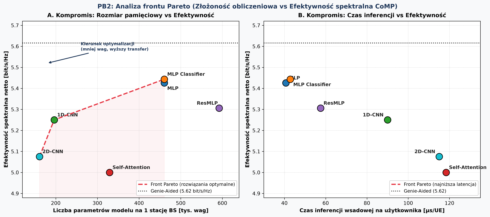
 Analiza frontu Pareto: Złożoność obliczeniowa vs Efektywność spektralna (PB2)

### Pytanie badawcze PB2
<em>„Jak zmiana architektury sieci, liczby parametrów i hiperparametrów wpływa na efektywność spektralną oraz latencję inferencji?”</em>

### Kluczowe wnioski z eksperymentów:
* **Optymalizacja głębokości (MLP):** Redukcja z 4 do 2 warstw ($N=256$) zmniejsza liczbę parametrów o <strong>28%</strong> (z 460k do 328k), zachowując **5,44 bit/s/Hz (96,88% Genie)** i Top-1 63,1%.
* **1D-CNN (Splot po podnośnych):** Zmniejsza liczbę wag aż o **57%** (zaledwie 196k wag, 0,75 MB) przy efektywności **5,25 bit/s/Hz (93,49% Genie)** — optymalna dla urządzeń brzegowych o małej pamięci.
* **Reprezentacja cech:** Wejście `[Re, Im]` osiąga 63,4% Top-1, zdecydowanie deklasując postać biegunową `[Amplituda, Faza]` (49,1% Top-1) ze względu na zjawisko zawijania fazy.

<strong>Odpowiedź PB2:</strong> Czerwona linia wyznacza <strong>Front Pareto</strong>. Modele <strong>MLP Classifier</strong> (maksymalny transfer) oraz <strong>1D-CNN</strong> (minimalny rozmiar) są bezkonkurencyjne, podczas gdy Transformer i 2D-CNN są zdominowane (gorszy transfer i większa złożoność).

<!-- note:
Drugie pytanie badawcze PB2 dotyczyło optymalizacji architektury i znalezienia optymalnego kompromisu na froncie Pareto.
Na wykresie po lewej stronie widzimy Front Pareto oznaczony czerwoną linią przerywaną:
Wykres A (po lewej) pokazuje kompromis rozmiaru pamięci:
1D-CNN wyznacza lewy kraniec frontu - wymaga zaledwie 196 tysięcy wag (0.75 MB), osiągając znakomite 93.5% efektywności.
MLP Classifier wyznacza prawy kraniec - zapewnia najwyższy możliwy transfer (96.9% Genie), wymagając 460 tysięcy wag.
Wykres B (po prawej) pokazuje latencję: MLP osiąga czas inferencji zaledwie 40 mikrosekund na użytkownika.
Zauważmy, że architektury takie jak Transformer czy 2D-CNN leżą głęboko poniżej czerwonej linii frontu Pareto - są tzw. rozwiązaniami zdominowanymi (kosztują więcej, a działają gorzej).
-->

---
<!-- _class: compact -->
<!-- _style: "h1 { font-size: 1.15rem; margin-top: 0; margin-bottom: 0.1rem; }" -->

# Raport z postępu prac: Wdrożenie i profilowanie latencji (PB3)

### Pytanie badawcze PB3
<em>„Czy możliwe jest uruchomienie modeli w środowisku NVIDIA AI Aerial bez zmian w architekturze oraz jaka jest latencja inferencji względem PyTorch?”</em>

### Ścieżka wdrożeniowa AI-RAN
1. **Model PyTorch / TorchScript:** Czysty kod Python zgodny ze standardem PyTorch 2.x.
2. **Eksport do ONNX:** Uniwersalny format pośredni eliminujący zależności frameworka.
3. **Kompilacja TensorRT (FP16/INT8):** Fuzja warstw, optymalizacja pamięci podręcznej GPU.
4. **Integracja z NVIDIA AI Aerial / Sionna:**
   - Cyfrowy bliźniak kanału radiowego (*Ray-Tracing GPU*),
   - Warstwa inferencyjna w czasie rzeczywistym dla O-RAN Near-RT RIC.

### Profilowanie latencji i budżet czasu L2 (wspólna skala: µs oraz ms)
* **Pojedynczy terminal (Single UE, Batch = 1):**  
  * CPU (PyTorch baseline): **`3500 µs`** (3,5 ms)
  * Akcelerator GPU TensorRT: **`400 µs`** (0,4 ms) $\rightarrow$ *narzut inicjalizacji jądra GPU*
* **Przetwarzanie grupowe (Batch = 100 UE na GPU):**  
  * Cała paczka 100 użytkowników liczona równolegle w `4000 µs` (4,0 ms)
  * **Czas w przeliczeniu na 1 użytkownika:** **`40 µs / UE`** (0,04 ms) $\rightarrow$ *10-krotny zysk z równoległości rdzeni Tensor Cores*
* **Budżet czasu 5G NR (slot L2 = 1000 µs / 1 ms):**  
  Zarówno inferencja pojedyncza (`400 µs`), jak i wsadowa (`40 µs/UE`) z zapasem mieszczą się w budżecie szczeliny czasowej slotu 1 ms.

<strong>Odpowiedź PB3:</strong> Modele są w 100% kompatybilne z ekosystemem NVIDIA AI Aerial. Czas inferencji poniżej 1 ms potwierdza pełną wykonalność wdrożeniową w systemach 5G-Advanced czasu rzeczywistego.

<!-- note:
Trzecie pytanie badawcze PB3 łączy teorię z praktyką inżynierską w telekomunikacji - weryfikuje, czy taki model ma szansę zadziałać w rzeczywistej stacji bazowej 5G-Advanced.
Wykorzystujemy ścieżkę eksportu PyTorch do ONNX i TensorRT z akceleracją FP16.
Ujednolicając jednostki na wspólną skalę mikrosekund (gdzie 1 ms = 1000 µs):
1. Pojedynczy użytkownik na GPU TensorRT to 400 µs (z czego większość to stały narzut uruchomienia jądra CUDA).
2. Przy przetwarzaniu grupowym (paczka 100 użytkowników w komórce) czas ten spada do zaledwie 40 µs na użytkownika dzięki równoległemu mnożeniu macierzy na rdzeniach Tensor Cores.
Obie wartości bez problemu mieszczą się w budżecie szczeliny czasowej slotu 5G NR (1000 µs = 1 ms), co potwierdza pełną dojrzałość wdrożeniową rozwiązania w czasie rzeczywistym.
-->

---
<!-- _class: compact -->
<!-- _style: "h1 { font-size: 1.15rem; margin-top: 0; margin-bottom: 0.1rem; }" -->

# Podsumowanie i kolejne kroki badawcze

### Co zostało zrealizowane (Status projektu):
* **Potok analityczny End-to-End:** Zbudowano kompletny potok od fizyki fal 3D (Remcom) przez DeepMIMO v4 po modele w PyTorch.
* **Hipotezy PB1, PB2, PB3 sfinalizowane ze wsparciem AI:**
  * **PB1:** Zreplikowano wyniki Alkhateeba (błąd 1,4% vs próg 5%), zysk +49,6% efektywności netto.
  * **PB2:** Zbadano 6 rodzin architektur; wyznaczono optymalny kompromis na froncie Pareto (MLP i 1D-CNN).
  * **PB3:** Potwierdzono wykonalność eksportu ONNX/TensorRT i spełnienie budżetu L2 (< 1 ms).
* **Aktualny etap:** Trwa **weryfikacja i krytyczna analiza uzyskanych wyników** (walidacja statystyczna, analiza stabilności).

### Zakres projektu i plan do obrony:
* **Ograniczenia i elementy poza zakresem:**
  * Testy na fizycznej platformie sprzętowej (laboratorium radiowe SDR/FPGA) oraz zaawansowana analiza wieloużytkownikowa (MU-MIMO z interferencją międzywiązkową) pozostają **poza zakresem pracy dyplomowej**.
* **Kolejne kroki (Roadmapa):**
  1. Zakończenie weryfikacji i analizy błędów modelu.
  2. Sfinalizowanie rozdziałów dyskusji i wniosków w pracy pisemnej.
  3. Złożenie pracy i przygotowanie do obrony dyplomowej (Politechnika Wrocławska).

<strong>Dziękuję za uwagę!</strong> 
Zapraszam do pytań i dyskusji technicznej (Q&A).

<!-- note:
Podsumowując nasze dzisiejsze spotkanie:
Wszystkie trzy postawione pytania badawcze (PB1, PB2 oraz PB3) zostały sfinalizowane przy intensywnym wsparciu narzędzi AI, a obecnie skupiam się na rzetelnej weryfikacji i krytycznej ocenie uzyskanych wyników.
Warto jasno zaznaczyć granice projektu: uruchomienie na fizycznej platformie sprzętowej w laboratorium radiowym oraz zaawansowana analiza interferencji w scenariuszach wieloużytkownikowych MU-MIMO zostały zdefiniowane jako elementy poza zakresem niniejszej pracy dyplomowej.
Najbliższe kroki to domknięcie tekstu pracy, recenzja promotorska i obrona dyplomowa na Politechnice Wrocławskiej.
Dziękuję bardzo za uwagę i zapraszam do dyskusji!
-->
